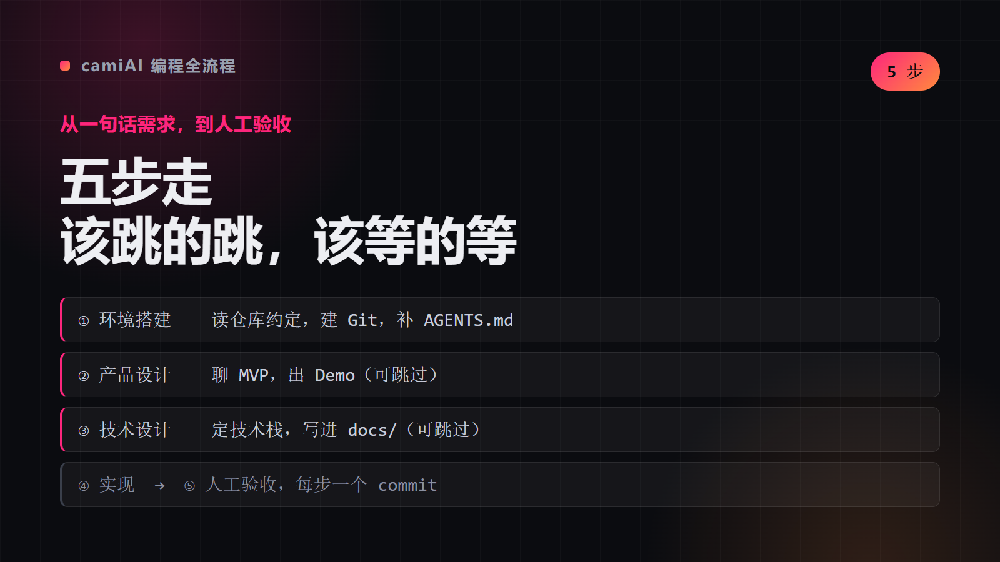

# camiAI 编程全流程

一份面向 AI 编程助手的可复用产品开发流程，帮助按固定顺序推进产品，并按需跳过产品设计或技术设计。

本仓库采用 [Agent Skills 开放格式](https://agentskills.io/specification)：核心说明在 `SKILL.md`，提示词模板在 `references/prompts.md`。同一份内容可供支持该格式的 Agent 使用，例如 Codex、Claude Code、Cursor、OpenCode 等。Agent 的安装目录和触发方式可能不同。

## 📺 看看效果




```
你说：我要做一个记账小程序
     ↓
① 环境搭建  检查 Git、项目说明、已有规则
② 产品设计  讨论 MVP，做带模拟数据的 Demo      ← 可跳过
③ 技术设计  定技术方案并记录                    ← 可跳过
④ 产品实现  写代码、跑测试、每个改动一个 commit
⑤ 人工验证  你实际用一遍，反馈后再改
```

> 五步走完，你拿到的是一个**跑得起来、能回退**的产品，不是一堆没验证的代码。

## What This Does

把「用 AI 写产品」从随机发挥变成固定流程：每一步有明确产出，每一步都能停下来检查，第 2、3 步可以按项目情况跳过。

### Key Features

- **顺序固定、可跳步**：默认五步，产品简单就直接实现
- **每步配提示词模板**：`references/prompts.md` 里直接复制
- **实现阶段强制 commit**：每个完成的改动一个 commit，永远能回退
- **最后一步交给人**：AI 不判断好不好用，只负责让它跑起来
- **跨 Agent 通用**：Codex、Claude Code、Cursor、OpenCode 都能用

## Usage

### 默认流程

1. 环境搭建：检查 Git、项目说明和已有 Agent 规则。
2. 产品设计：讨论产品方案、MVP，并按需制作模拟数据 Demo。可跳过。
3. 技术设计：讨论并记录认可的技术方案。可跳过。
4. 产品实现：写代码、更新测试、运行验证，并为每个完成的改动建立 Git commit。
5. 人工验证：由用户实际体验，提供反馈后继续修正。

用户可以按产品明确跳过第 2、3 步；默认按顺序执行。提示词模板见 [`references/prompts.md`](references/prompts.md)。

## Installation

### 推荐：使用 skills 安装器

先安装 [Node.js](https://nodejs.org/)，然后在终端运行：

```bash
npx skills add chengangrun-ai/camiai-programming-workflow
```

按提示选择要安装的 Agent。要安装到这台电脑上该安装器识别的全部 Agent，可运行：

```bash
npx skills add chengangrun-ai/camiai-programming-workflow --all
```

安装器当前支持 Codex、Claude Code、Cursor、OpenCode 等多种 Agent；完整名单和命令以 [skills 安装器说明](https://github.com/vercel-labs/skills)为准。安装后，Agent 通常会按任务自动加载本流程；需要手动调用时，使用该 Agent 自己的 Skill 命令。

### 手动安装

下载或克隆整个仓库，把它放进目标 Agent 支持的 skills 目录，确保文件仍是 `camiai-programming-workflow/SKILL.md` 和 `camiai-programming-workflow/references/prompts.md`。各 Agent 的目录不同，请按对应产品的说明选择项目级或用户级目录。

若 Agent 没有 Skill 自动发现功能，但能读取本地文件，可直接告诉它：

```text
请读取 camiai-programming-workflow/SKILL.md，并按其中的流程协助我开发产品；需要时再读取 references/prompts.md。
```

`$camiai-programming-workflow` 是 Codex 的调用方式，不是所有 Agent 通用的命令。`agents/openai.yaml` 也只是 Codex 的可选界面信息，其他 Agent 可以忽略；跨平台流程以 `SKILL.md` 和 `references/` 为准。

## 兼容范围

这份 Skill 面向支持 Agent Skills 开放格式，或能读取 Markdown 文件并遵循其中说明的 Agent。Agent Skills 不能让完全不支持 Skill 或本地文件读取的产品自动加载本流程；这类产品需要由用户通过其支持的方式提供 `SKILL.md` 内容。

## Architecture

```text
camiai-programming-workflow/
├── SKILL.md
├── README.md
├── LICENSE
├── agents/
│   └── openai.yaml  # Codex 可选界面信息
└── references/
    └── prompts.md
```

| 文件 | 作用 | 何时加载 |
|---|---|---|
| `SKILL.md` | 五步流程的完整定义与判断规则 | 每次会话 |
| `references/prompts.md` | 每一步可直接复制的提示词模板 | 进入对应步骤时 |
| `agents/openai.yaml` | Codex 的界面元信息 | 仅 Codex |

## Philosophy

1. **流程固定，但不强制。** 五步顺序是默认路径，不是牢笼。产品简单就跳过设计，直接实现——但跳过要由用户明确决定，不由 AI 自作主张。
2. **每一步都有可复制的提示词。** 不给模板的"流程"只是口号，落不了地。
3. **实现阶段必须建 commit。** 每个完成的改动一个 commit，让"回退到能用的版本"永远可行。
4. **最后一步交给人。** AI 不判断产品好不好用，只负责让它跑起来。

## Requirements

- 支持 Agent Skills 格式、或能读取 Markdown 并遵循说明的 Agent
- 不需要任何运行时依赖

## Credits

Created by Cami · [@chengangrun-ai](https://github.com/chengangrun-ai).

## License

本项目采用 MIT License，详见 [`LICENSE`](LICENSE)。


